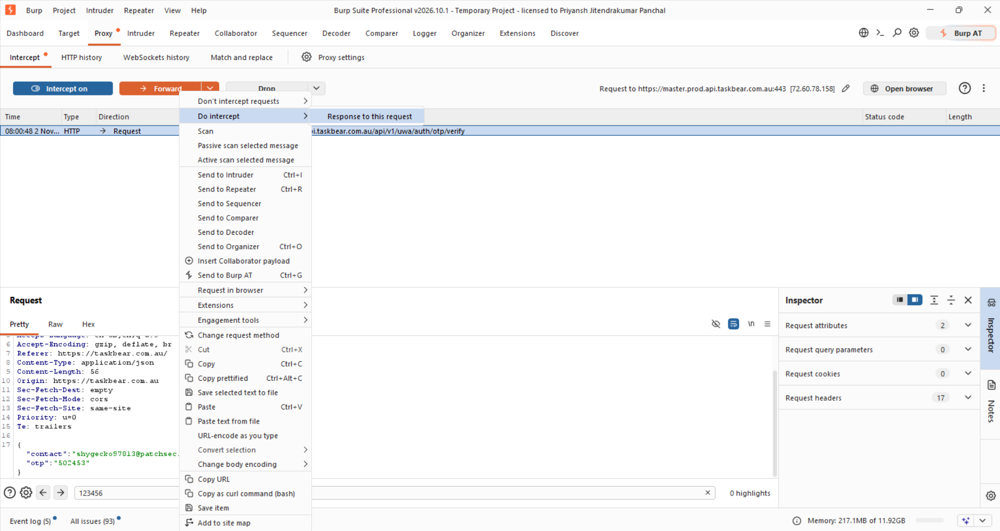

## Title

# Email Verification OTP Bypass During User Registration in TaskBear Sign-up Page

## Severity
Medium

## OWASP Top 10:2025
A07 – Authentication Failures

## Vulnerability Type
Email Verification OTP Bypass

## Summary

The TaskBear sign-up process allows email verification OTP to be bypassed, potentially enabling account registration without successful email ownership verification.

This vulnerability may weaken the application's email verification controls. The overall security impact depends on whether the server enforces verification before account activation and access to protected features.

## Affected Asset

- **Application:** TaskBear
- **Affected Page:** Sign-Up / Registration Page
- **Affected URL:** https://taskbear.com.au/auth/sign-up?redirect=%2F
- **Vulnerability:** Email Verification OTP Bypass

## Steps to Reproduce (PoC)

1. Navigate to the TaskBear sign-up page.
2. Enter the required registration details and an email address you control.
3. Request the email verification OTP.
4. Perform the observed OTP bypass without successfully verifying the OTP.
5. Check whether the application completes registration without successful email verification.
6. Record the result and capture screenshots as evidence.

## Proof of Concept (PoC)

### Screenshot 1: Sign-Up Page
Shows the application's registration page before email verification.

### Screenshot 2: OTP Verification
Shows the email OTP verification step during registration.

### Screenshot 3: Verification Bypass
Shows the observed behavior when the OTP verification step is bypassed.

### Screenshot 4: Registration Result
Shows the final registration result after the attempted OTP bypass.

## Impact

- **Email Ownership Verification Bypass:** Users may be able to register accounts without proving ownership of the submitted email address.
- **Unverified Account Creation:** The application may create or activate accounts before email verification is completed.
- **Potential Abuse of Registration:** Attackers may exploit the weakness to create accounts using email addresses they do not control.
- **Trust and Integrity Risks:** The application's email verification process may not reliably establish email ownership.

## Remediation

- **Enforce Server-Side OTP Verification:** Require successful OTP validation on the server before activating an account or completing registration.
- **Bind OTP to the Email Address:** Ensure each OTP is associated with the specific email address and registration session for which it was generated.
- **Prevent Verification Bypass:** Do not rely solely on frontend validation, hidden fields, or client-side navigation to enforce email verification.
- **Implement OTP Expiration:** Ensure OTPs expire after a limited period and cannot be reused after successful validation.
- **Apply Rate Limiting:** Restrict OTP generation and verification attempts to prevent brute-force attacks and abuse.
- **Validate Account Status:** Maintain a server-side verification status and prevent unverified accounts from accessing protected functionality.
- **Invalidate Pending OTPs:** Invalidate previous OTPs when a new OTP is generated, according to the application's verification policy.